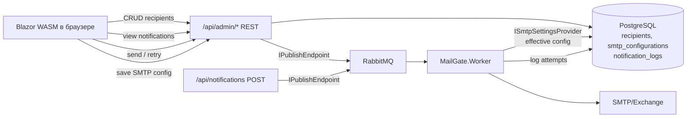

## Архитектурные решения

- **UI:** Blazor WebAssembly SPA + [MudBlazor](https://mudblazor.com) как UI-kit (готовые таблицы, диалоги, формы, темы).
- **Хостинг:** WASM-статика отдаётся существующим `MailGate.Api` (через `UseBlazorFrameworkFiles` + `MapFallbackToFile`). Админ-эндпоинты живут в том же API под префиксом `/api/admin/*`. Один контейнер, одно публичное приложение.
- **Shared DTO:** новый проект `MailGate.Contracts` подключается и в API, и в WASM — гарантирует синхронность контрактов без дублирования.
- **SMTP hybrid:** новый интерфейс `ISmtpSettingsProvider` в `MailGate.Channels.Smtp`. Реализация в `MailGate.Infrastructure` читает override из БД (кэш 30 с через `IMemoryCache`), fallback — `IOptions<SmtpOptions>` из appsettings. `SmtpChannel` перестаёт зависеть от `IOptions<SmtpOptions>` напрямую и получает настройки через провайдер на каждой отправке.
- **Retry неудачных рассылок:** расширяем `NotificationLog` полем `PayloadJson` (jsonb) с полным сериализованным `NotificationMessage`. Endpoint `POST /api/admin/notifications/{id}/retry` десериализует payload, публикует с новым `MessageId` и `RetryOfMessageId = originalId`.
- **Секреты SMTP:** пароль и `ClientSecret` шифруются через ASP.NET Core Data Protection перед сохранением в БД.
- **Без аутентификации** на первом этапе (по выбору пользователя).

## Поток данных



## Изменения по проектам

### Новый: [src/MailGate.Contracts/](src/MailGate.Contracts/)
Чистые DTO, общие для API и WASM:
- `RecipientDto`, `CreateRecipientDto`, `UpdateRecipientDto`
- `NotificationLogDto`, `NotificationFilterDto`, `SendNotificationFromAdminDto`, `RetryNotificationResponseDto`
- `SmtpConfigurationDto`, `UpdateSmtpConfigurationDto`, `SmtpTestResultDto`
- `PagedResult<T>`

### [src/MailGate.Core/](src/MailGate.Core/)
Новые сущности:
- `Entities/Recipient.cs` — `Id`, `FullName`, `Email` (unique), `CreatedAt`, `UpdatedAt`
- `Entities/SmtpConfiguration.cs` — singleton override (одна активная запись): `Host`, `Port`, `UseTls`, `FromAddress`, `FromName`, `Username`, `EncryptedPassword`, OAuth2-поля, `UpdatedAt`
- Расширение [src/MailGate.Core/Entities/NotificationLog.cs](src/MailGate.Core/Entities/NotificationLog.cs): новые поля `PayloadJson` (nvarchar/jsonb), `RetryOfMessageId` (Guid?).

### [src/MailGate.Infrastructure/](src/MailGate.Infrastructure/)
- [Persistence/MailGateDbContext.cs](src/MailGate.Infrastructure/Persistence/MailGateDbContext.cs): `DbSet<Recipient>`, `DbSet<SmtpConfiguration>`, маппинг новых полей `NotificationLog`.
- Новая миграция `AddAdminEntities` (`recipients`, `smtp_configurations`, новые колонки в `notification_logs`).
- Репозиторий/сервис `SmtpConfigurationStore` — чтение/запись с Data Protection encryption/decryption.
- `DbSmtpSettingsProvider : ISmtpSettingsProvider` с кэшем на 30 с через `IMemoryCache`.

### [src/MailGate.Channels.Smtp/](src/MailGate.Channels.Smtp/)
- Новый интерфейс `ISmtpSettingsProvider` с методом `Task<SmtpOptions> GetEffectiveAsync(CancellationToken)`.
- Дефолтная реализация `OptionsSmtpSettingsProvider` — возвращает `IOptions<SmtpOptions>` (для обратной совместимости).
- [SmtpChannel.cs](src/MailGate.Channels.Smtp/SmtpChannel.cs): конструктор принимает `ISmtpSettingsProvider` вместо `IOptions<SmtpOptions>`; перед `SendAsync` запрашивает актуальные настройки.
- В `ServiceCollectionExtensions.AddSmtpChannel` регистрируется `OptionsSmtpSettingsProvider` по умолчанию; Worker перерегистрирует его на `DbSmtpSettingsProvider`.

### [src/MailGate.Api/](src/MailGate.Api/)
Новая папка `Admin/Endpoints/`:
- `RecipientsEndpoints.cs` — `/api/admin/recipients` CRUD + search/pagination.
- `NotificationsAdminEndpoints.cs`:
  - `GET /api/admin/notifications?status=&search=&page=&pageSize=` — список с фильтрами.
  - `GET /api/admin/notifications/{id}` — детали (включая полный payload и стек ошибки).
  - `POST /api/admin/notifications` — отправить новую (принимает `recipientIds[]` из справочника + тема/тело/канал, собирает `NotificationMessage`, публикует).
  - `POST /api/admin/notifications/{id}/retry` — republish по `PayloadJson`.
- `SmtpAdminEndpoints.cs`:
  - `GET /api/admin/smtp` — effective config (из БД или appsettings) + источник.
  - `PUT /api/admin/smtp` — сохранить override, шифруя секреты.
  - `DELETE /api/admin/smtp` — удалить override.
  - `POST /api/admin/smtp/test` — попытка TLS-handshake + AUTH с переданными параметрами, без отправки письма.
- Подключение Blazor WASM в [Program.cs](src/MailGate.Api/Program.cs):
  ```csharp
  app.UseBlazorFrameworkFiles();
  app.UseStaticFiles();
  app.MapFallbackToFile("index.html");
  ```
- FluentValidation-валидаторы для всех новых DTO.

### [src/MailGate.Worker/](src/MailGate.Worker/)
- В `Program.cs` заменить дефолтный `OptionsSmtpSettingsProvider` на `DbSmtpSettingsProvider`, добавить `AddMemoryCache`, `AddDataProtection`.
- Расширить [NotificationMessageConsumer.cs](src/MailGate.Worker/Consumers/NotificationMessageConsumer.cs): в `UpsertLogAsync` сохранять `PayloadJson` и `RetryOfMessageId` (если есть в хедерах MassTransit).

### Новый: [src/MailGate.Admin/](src/MailGate.Admin/) — Blazor WASM
Стандартная структура WASM + MudBlazor:
- `Program.cs`: `AddMudServices`, `HttpClient` на `BaseAddress = /`.
- `Services/` — тонкие клиенты (`RecipientsClient`, `NotificationsClient`, `SmtpClient`) с типизированными методами поверх `HttpClient`.
- `Pages/Recipients.razor` — `MudDataGrid<RecipientDto>` с inline-редактированием, диалогом создания.
- `Pages/Notifications.razor` — таблица с фильтром по статусу (`All/Succeeded/Failed/Skipped`), поиском по email/subject/messageId, пагинацией; в строке `Failed` кнопка "Повторить"; клик по строке открывает диалог с деталями и stacktrace.
- `Pages/NotificationCreate.razor` — `MudAutocomplete` multi-select получателей из справочника, поля темы/тела (`MudTextField` multiline с выбором `BodyFormat`), выбор канала.
- `Pages/SmtpSettings.razor` — форма с вкладками "Основные" / "OAuth2", кнопка "Проверить соединение", индикатор источника (appsettings / БД).
- `Layout/MainLayout.razor` + `NavMenu.razor` — навигация по 4 разделам: Получатели, Рассылки, Создать рассылку, SMTP.

### [docker-compose.yml](docker-compose.yml)
Никаких новых сервисов не нужно — WASM-статика собирается и кладётся в `wwwroot` api при `dotnet publish`. Обновится только Dockerfile API: добавить копирование `MailGate.Admin` + `MailGate.Contracts` в build-stage.

### [README.md](README.md)
Обновить: раздел "Админка" с описанием путей (`/` → Blazor UI, `/swagger` → API docs), перечень возможностей, скриншоты опционально.

## Маршруты UI

| URL браузера | Страница |
|-------------|----------|
| `/` | Dashboard (короткая статистика — счётчики Sent/Failed за сутки) |
| `/recipients` | Справочник получателей |
| `/notifications` | История рассылок |
| `/notifications/new` | Создать рассылку |
| `/smtp-settings` | Настройки SMTP |
| `/swagger` | Swagger UI (остаётся) |
| `/scalar/v1` | Scalar (остаётся) |

## Вне scope этой итерации (phase 2)

- Аутентификация — договорились добавить позже.
- Группы получателей — выбрали address-book-only.
- Каналы кроме SMTP — архитектура уже это позволяет, но UI добавлять не будем.
- Rate limiting на админ-эндпоинтах.